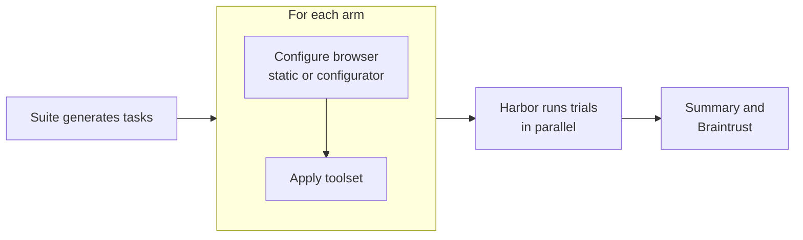

# Kernel Benchmarks

**How well do AI agents get everyday things done on the real web, and what makes them better?**

Booking a table, applying for a job, or finding a store's hours sounds easy until an agent has to do it on a live website. Success depends on more than the model:

- **Browser tools.** Is the agent driving Playwright code, a screenshot-and-click loop, or a purpose-built API?
- **Browser settings.** Is the browser stealthy? Which proxy does it use? Does the site even let it in?
- **Guidance.** Does the agent know what a site's bot protection looks for before it starts?

This repo measures those choices side by side. Each benchmark runs a set of real-website tasks under several configurations, called **arms**, in the same time window. You can then see what changed the outcome: the agent, its tools, or its browser.

Each attempt at one task under one arm is a **trial**. Trials run on [Harbor](https://github.com/harbor-framework/harbor), an open framework for agent evaluations. Every trial gets its own [Kernel](https://www.kernel.sh) cloud browser, created fresh and deleted afterwards.

### What you need

Running trials uses paid services:
- a Kernel account,
- an OpenAI or Anthropic key for the agent,
- for ClawBench, a [PurelyMail](https://purelymail.com) account with a mail domain you control and an LLM judge endpoint.

A full ClawBench run is 129 trials per arm. [Preparing tasks](#quick-start) for the static arms is free and needs no credentials, so you can inspect exactly what would run before spending anything.

## How a benchmark is put together

| Piece | What it is | Example |
|---|---|---|
| **Suite** | A set of tasks, adapted into Harbor tasks, with its own scoring. | [ClawBench](https://github.com/TIGER-AI-Lab/ClawBench): 129 tasks on real websites, scored by intercepting the final request |
| **Toolset** | What the agent uses to drive the browser. | `kernel-mcp-local`: the [Kernel MCP server](https://github.com/kernel/kernel-mcp-server), built from source |
| **Agent** | A Harbor agent, model, and version. | Codex with `gpt-5.6-luna` |
| **Arm** | One agent + toolset + browser configuration. The thing being compared. | `codex-kernel-mcp-site-config` |
| **Configurator** | Optional. Picks browser settings per task, and can add advice for the agent. | `site-config`: asks Kernel's [config registry](https://kernel.sh/docs/config-registry) what works on the task's site |
| **Benchmark** | A suite plus the arms to run on it. One GitHub workflow each. | `kernel-mcp-clawbench` |

A run turns those into trials:



Inside a trial:

1. Harbor creates a headful Kernel browser with that task's settings. The browser is a full VM.
2. Inside the VM, Harbor builds the task's image with Docker and installs the agent in that container. Toolsets built from source, like the Kernel MCP server, are built here too, which is why each trial spends a few minutes on setup.
3. The agent completes the task by driving the VM's browser through its toolset.
4. The suite's verifier scores the result. Harbor then deletes the browser.

## Quick start

You need [uv](https://docs.astral.sh/uv/). Preparing tasks for arms without a configurator needs no credentials:

```bash
uv sync
uv run bench prepare kernel-mcp-clawbench \
  --arms codex-kernel-mcp --tasks v2-1134-chapter-finder-redcross --out /tmp/prepared
```

This writes ready-to-run Harbor tasks you can inspect: `task.toml`, the instruction, the Dockerfile, and `environment/kernel-config.json` with the browser settings.

To run trials, export the credentials listed below, then:

```bash
uv run bench run kernel-mcp-clawbench \
  --arms codex-kernel-mcp --tasks v2-1134-chapter-finder-redcross
```

Harbor writes one job directory per arm under `jobs/`, containing rewards, trajectories, and verifier output. To summarize jobs, run `bun report/report.ts --arm <name>=<job dir>` (needs [Bun](https://bun.sh)).

`--tasks` takes comma-separated task IDs or `all`. `--concurrency` sets concurrent trials per arm. `--attempts` runs each task that many times per arm. `--toolset-ref` builds a toolset from a specific git ref, e.g. a Kernel MCP server branch.

The run also writes `jobs/run-<id>.json`, which maps each arm to its job directory, exit status, and the browser settings and site guidance each task got.

A run of two arms on two tasks (Red Cross and Indeed) produced this summary:

| Arm | Configuration | Lenient | Strict | Intercepted | Infra | Retries | Ungraded | Kernel MCP valid | Median calls | Median duration | Cost |
|---|---|---:|---:|---:|---:|---:|---:|---:|---:|---:|---:|
| codex-kernel-mcp | codex@0.120.0 · gpt-5.6-luna · config 14a94e93 | 1/2 | 1/2 | 1/2 | 0 | 0 | 0 | 2/2 | 9 | 216s | $0.0281 |
| codex-kernel-mcp-site-config | codex@0.120.0 · gpt-5.6-luna · config 14a94e93 | 1/2 | 1/2 | 1/2 | 0 | 0 | 0 | 2/2 | 16 | 302s | $0.0422 |

### Credentials

| Variable | Used by |
|---|---|
| `KERNEL_API_KEY` | Browsers, the config registry, and Kernel MCP. Use an [API key scoped](https://kernel.sh/docs/info/api-keys) to a [project](https://kernel.sh/docs/info/projects) used only for benchmarks; the run checks this before starting. |
| `OPENAI_API_KEY` / `ANTHROPIC_API_KEY` | Codex and Claude Code arms; the `site-config` configurator's model |
| `PURELY_MAIL_API_KEY`, `PURELY_MAIL_DOMAIN` | ClawBench creates a disposable [PurelyMail](https://purelymail.com) mailbox on your domain for every task, so agents can sign up and receive confirmation emails. |
| `CLAWBENCH_JUDGE_BASE_URL`, `CLAWBENCH_JUDGE_API_KEY`, `CLAWBENCH_JUDGE_MODEL`, `CLAWBENCH_JUDGE_API_TYPE` | ClawBench's LLM judge, which checks the intercepted request against the task. Any OpenAI-compatible endpoint works with `CLAWBENCH_JUDGE_API_TYPE=openai-completions`; we use `deepseek/deepseek-v4-pro` through OpenRouter. See [ClawBench](https://github.com/TIGER-AI-Lab/ClawBench) for details. |
| `BROWSERBASE_API_KEY`, `BROWSERBASE_PROJECT_ID`, `STEEL_API_KEY`, `HYPERBROWSER_API_KEY`, `ANCHOR_API_KEY` | Arms on those providers' browsers (`environment = "remote-browser"`); checked before a run that includes them |
| `EV_APP_UUID`, `EV_API_KEY` | `codex-pw-kernel-evervault`, which mints an Evervault Browser Tokens session per trial for its proxy. The key needs `browserToken:create`. |
| `BRAINTRUST_API_KEY`, `BRAINTRUST_PROJECT` | Optional: publishing results |

## Running in GitHub Actions

Each benchmark has a manually triggered workflow:

```bash
gh workflow run kernel-mcp-clawbench.yml -f tasks=all -f concurrency=10
```

The job summary shows a table per arm. When Braintrust is configured, each run is also published there as one experiment with redacted trajectories. Raw job directories are never uploaded, because they contain task credentials.

GitHub stops jobs after six hours. Arms still running then are reported as incomplete. Lower the task count or raise `concurrency` for large runs.

## Current benchmarks

### `kernel-mcp-clawbench`

The Kernel MCP server on ClawBench.

| Arm | Agent | Browser |
|---|---|---|
| `codex-kernel-mcp` | Codex, `gpt-5.6-luna` | Stealth |
| `codex-kernel-mcp-site-config` | Codex, `gpt-5.6-luna` | From Kernel's config registry per site, plus the registry's guidance in the instruction. On Indeed, for example, it picks a US ISP proxy; the stealth-only arm was stopped by Cloudflare there. |
| `claude-kernel-mcp` | Claude Code, `claude-sonnet-5` | Stealth |

ClawBench's primary score is the lenient reward. `kernel_mcp_valid` records whether the agent called Kernel MCP's `execute_playwright_code` and used its assigned browser on every call, so a failed task can be told apart from a trial that never used the toolset.

### `retail-cart`

Guest add-to-cart tasks on 16 retail and industrial-supply sites with heavy bot protection. Each task starts on the site's home page and asks the agent to put one item in the site's cart as a guest, by whatever route works, and show the cart.

| Arm | Agent | Browser |
|---|---|---|
| `codex-repl` | Codex, `gpt-6-luna`, Kernel MCP's `browser_repl` only | `stealth: true` and no proxy, so each browser gets its own egress IP from the stealth proxy pool |
| `codex-repl-site-config` | Same; `gpt-6-luna` also picks the site and proxy for the configurator | From Kernel's config registry per site, plus its guidance. Each trial gets its own proxy. |
| `codex-repl-pinned` | Same, plus Kernel MCP's `computer_action` | A fixed per-site table (`configurators/pinned/sites.toml`): stealth, GPU, a new US ISP or residential proxy per trial, a macOS persona or VM setup on some sites, and per-site guidance |

The agent ends each task by calling the `bench` MCP server's `finalize` tool with its evidence and an outcome: `success`, `failed`, `blocked` (bot protection stopped it), `website_error` or `kernel_error`. `reward` is 1 for a reported success, and `outcome_<name>` records the failure, so bot blocks are counted apart from the agent's own failures.

The verifier then checks the cart itself. It reads the page the agent ended on if that is the cart, otherwise opens the task's `cart_url` or fetches its `cart_api`, and sets `cart_verified` when the item is listed. When it could not see the cart, because loading it failed or showed a bot check, it sets `cart_unverifiable` instead.

Run several attempts per task to get a pass rate per site:

```bash
uv run bench run retail-cart --attempts 10
```

### `retail-cart-providers`

The `retail-cart` tasks on each browser provider's browser. Every arm uses the same agent (Codex, `gpt-6-luna`), the same tools ([Playwright MCP](https://github.com/microsoft/playwright-mcp) attached over CDP) and the same task container on the runner's Docker, so arms differ only in the browser. Each provider gets its own anti-bot settings:

| Arm | Browser |
|---|---|
| `codex-pw-kernel` | Kernel, `stealth: true` |
| `codex-pw-kernel-evervault` | Kernel, `stealth: true`, with the whole session sent through Evervault's browser proxy: a new Evervault session and Kernel custom proxy with Evervault's CA per trial |
| `codex-pw-browserbase` | Browserbase, Advanced Stealth (Scale plan), CAPTCHA solving, its residential proxies |
| `codex-pw-steel` | Steel, residential proxy and CAPTCHA solving |
| `codex-pw-hyperbrowser` | Hyperbrowser, stealth, proxy and CAPTCHA solving |
| `codex-pw-anchor` | Anchor, its US proxy, extra stealth and CAPTCHA solving |

The start page, the agent and the verifier each connect to the browser separately, so sessions are created to outlive a CDP disconnect (Browserbase's `keepAlive`, Anchor's idle timeout). Scoring is the same as `retail-cart`.

```bash
uv run bench run retail-cart-providers --attempts 10 --concurrency 4
```

All arms' task containers run on one machine, so keep `--concurrency` low on a GitHub runner.

### `retail-cart-geo`

The `retail-cart` tasks reached from each site's own market, for sites outside the US. Tasks need a `country`, so pass a task file of the same shape as `suites/retail-cart/tasks.toml` with `--suite-arg tasks=<path>`.

| Arm | Browser |
|---|---|
| `codex-pw-kernel-geo` | Kernel, `stealth: true`, with a new residential proxy in the task's country per trial (the `geo` configurator) |
| `codex-pw-kernel-evervault-eu` | Kernel, `stealth: true`, with the whole session sent through Evervault's EU (Ireland) relay |

```bash
uv run bench run retail-cart-geo --suite-arg tasks=path/to/tasks.toml --attempts 5
```

## Extending

### Add an arm

Copy a file in `arms/` and add its name to a benchmark:

```toml
agent = "claude-code"          # any Harbor agent
model = "claude-sonnet-5"
agent_version = "2.1.238"
toolset = "kernel-mcp-local"

[browser]
config = { stealth = true }    # Kernel POST /browsers params
configurator = "site-config"   # optional; its output is merged over config

[browser.configurator_args]
model = "anthropic/claude-haiku-5-5"
steering = true
```

`toolset_args` are passed to the toolset; `kernel-mcp-local` takes `toolsets`, the Kernel MCP toolsets to enable: `playwright` (the default), `repl`, `computer`, or several. `agent_kwargs` are passed to the Harbor agent.

An arm with `environment = "remote-browser"` runs the task container on local Docker instead of in the Kernel browser's VM, and its `config` names a `provider` from `harness/providers.py` and that provider's session create `params`. The environment writes the browser's CDP URL to `/run/browser/cdp-url` in the container; the `playwright-mcp` toolset connects to it.

`config` takes any [`POST /browsers`](https://kernel.sh/docs/api-reference/browsers/create-a-browser-session) parameter, such as `stealth`, `proxy`, `region`, `extensions`, or `viewport`. Browsers are always headful.

### Add a configurator

A configurator is an executable at `configurators/<name>/configure`. It reads a task on stdin and prints browser settings on stdout:

```
stdin:  {"task": {"config": "<task.toml>", "instruction": "<instruction>"}, "args": {...}}
stdout: {"browser": {"stealth": true}, "steering": "advice for the agent" | null, "provenance": {...}}
```

`browser` may include `proxy_create`, a [`POST /proxies`](https://kernel.sh/docs/proxies/overview) body: each trial then gets its own proxy, deleted when the trial ends. A trial whose proxy cannot be created fails with `ProxyCreationError`, which the report lists under infrastructure failures. `browser` may also include `chromium_env`, `KERNEL_*` Chromium launcher variables (or a list of sets, one picked per trial), and `vm_setup`, shell commands run as root in the browser's VM. Both are applied right after the browser is created, before the first page load; a trial where either fails fails with `VmSetupError`. The configurator never sees the verifier's files. `steering` is appended to the task instruction under "Site guidance". Each task's result is recorded in `jobs/run-<id>.json`. Configurators may be nondeterministic, e.g. when they call an LLM.

`site-config` works like this:
1. A model names the task's primary website.
2. The [config registry](https://kernel.sh/docs/config-registry) looks it up. The registry is Kernel's record of which browser and proxy settings have reached a site, and what its bot protection reacted to.
3. A model translates the recommended proxy recipe into a Kernel proxy. Each trial creates its own proxy before its browser and deletes it afterwards, so trials never share an ISP IP; `bench run` deletes any a crashed trial left behind.
4. With `steering = true`, the registry's guidance for the site is added to the instruction.

### Add a toolset

Create `toolsets/<name>/toolset.py` with `apply(task_dirs, ref=None)`. It edits generated tasks, typically by:

- appending a layer to `environment/Dockerfile`,
- setting `environment.mcp_servers` in `task.toml`,
- adding instructions,
- appending a check to the verifier.

See `harness/tasks.py` for helpers.

### Add a suite

Create `suites/<name>/suite.py` with:

- `preflight()`: checks external dependencies before any browser is created.
- `generate(task_ids, out_dir)`: writes Harbor tasks and returns their directories. The tasks should run on the browser Harbor provides (`KERNEL_SESSION_ID`, `/harbor/kernel/connection.json`) and leave tool wiring to toolsets.

Then add `benchmarks/<name>.toml` and a workflow that calls `_run.yml`.

## Layout

```
benchmarks/      suite + arms per benchmark
arms/            agent, model, toolset, browser settings
suites/          task sets adapted to Harbor
toolsets/        browser tools for the agent
configurators/   per-task browser settings and guidance
harness/         preparation and running (Python)
report/          summary table and Braintrust publishing (TypeScript)
tests/
```

## Caveats

- **Live websites change.** Arms in one run share the same time window. Compare arms within a run rather than across days.
- **The Harbor provider is pinned to a fork.** Harbor is pinned to a `kernel/harbor` commit until [harbor-framework/harbor#2122](https://github.com/harbor-framework/harbor/pull/2122) is released.
- **Reporting assumes ClawBench.** The report and Braintrust publisher expect ClawBench-shaped rewards and step layout. They will be generalized when a second suite lands.

## License

[MIT](LICENSE)
