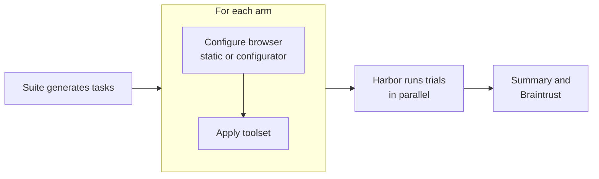

# Kernel Benchmarks

**How well do AI agents get everyday things done on the real web, and what makes them better?**

Booking a table, applying for a job, or finding a store's hours sounds easy until an agent has to do it on a live website. Success depends on more than the model:

- **Browser tools.** Is the agent driving Playwright code, a screenshot-and-click loop, or a purpose-built API?
- **Browser settings.** Is the browser stealthy? Which proxy does it use? Does the site even let it in?
- **Guidance.** Does the agent know what a site's bot protection looks for before it starts?

This repo measures those choices side by side. Each benchmark runs a set of real-website tasks under several configurations, called **arms**, in the same time window. You can then see what changed the outcome: the agent, its tools, or its browser.

Each attempt at one task under one arm is a **trial**. Trials run on [Harbor](https://github.com/harbor-framework/harbor), an open framework for agent evaluations. Every trial gets its own [Kernel](https://www.kernel.sh) cloud browser, created fresh and deleted afterwards.

### What you need

Running trials uses paid services:
- a Kernel account,
- an OpenAI or Anthropic key for the agent,
- for ClawBench, a [PurelyMail](https://purelymail.com) account with a mail domain you control and an LLM judge endpoint.

A full ClawBench run is 129 trials per arm. [Preparing tasks](#quick-start) for the static arms is free and needs no credentials, so you can inspect exactly what would run before spending anything.

## How a benchmark is put together

| Piece | What it is | Example |
|---|---|---|
| **Suite** | A set of tasks, adapted into Harbor tasks, with its own scoring. | [ClawBench](https://github.com/TIGER-AI-Lab/ClawBench): 129 tasks on real websites, scored by intercepting the final request |
| **Toolset** | What the agent uses to drive the browser. | `kernel-mcp-local`: the [Kernel MCP server](https://github.com/kernel/kernel-mcp-server), built from source |
| **Agent** | A Harbor agent, model, and version. | Codex with `gpt-5.6-luna` |
| **Runner preset** | Reusable agent, model, version and agent options, independent of browser approach. | `pi`, `claude`, `codex` in `runners/` |
| **Arm** | One agent + toolset + browser configuration. The thing being compared. | `codex-kernel-mcp-site-config` |
| **Configurator** | Optional. Picks browser settings per task, and can add advice for the agent. | `site-config`: asks Kernel's [config registry](https://kernel.sh/docs/config-registry) what works on the task's site |
| **Benchmark** | A suite plus the arms to run on it. One GitHub workflow each. | `kernel-mcp-clawbench` |

A run turns those into trials:



Inside a trial:

1. Harbor creates a headful Kernel browser with that task's settings. The browser is a full VM.
2. Inside the VM, Harbor builds the task's image with Docker and installs the agent in that container. Toolsets built from source, like the Kernel MCP server, are built here too, which is why each trial spends a few minutes on setup.
3. The agent completes the task by driving the VM's browser through its toolset.
4. The suite's verifier scores the result. Harbor then deletes the browser.

## Quick start

You need [uv](https://docs.astral.sh/uv/). Preparing tasks for arms without a configurator needs no credentials:

```bash
uv sync
uv run bench prepare kernel-mcp-clawbench \
  --arms codex-kernel-mcp --tasks v2-1134-chapter-finder-redcross --out /tmp/prepared
```

This writes ready-to-run Harbor tasks you can inspect: `task.toml`, the instruction, the Dockerfile, and `environment/kernel-config.json` with the browser settings.

To run trials, export the credentials listed below, then:

```bash
uv run bench run kernel-mcp-clawbench \
  --arms codex-kernel-mcp --tasks v2-1134-chapter-finder-redcross
```

Harbor writes one job directory per arm under `jobs/`, containing rewards, trajectories, and verifier output. To summarize jobs, run `bun report/report.ts --arm <name>=<job dir>` (needs [Bun](https://bun.sh)).

`--tasks` takes comma-separated task IDs or `all`. `--concurrency` sets concurrent trials per arm. `--toolset-ref` builds a toolset from a specific git ref, e.g. a Kernel MCP server branch. `--runner` selects a preset from `runners/` and `--model` overrides its model, for every selected arm. Both also work with `bench prepare`; a model override alone does not change the runner.

The run also writes `jobs/run-<id>.json`, which maps each arm to its job directory, exit status, resolved runner/model/version/options, and the browser settings and site guidance each task got. Each job's `task-plan.json` records task metadata and intended attempt counts before Harbor starts, so reporting does not depend on the verifier having run. Use a unique `--run-id` for each experiment; an existing run manifest is never overwritten.

A run of two arms on two tasks (Red Cross and Indeed) produced this summary:

| Arm | Configuration | Lenient | Strict | Intercepted | Infra | Retries | Ungraded | Kernel MCP valid | Median calls | Median duration | Cost |
|---|---|---:|---:|---:|---:|---:|---:|---:|---:|---:|---:|
| codex-kernel-mcp | codex@0.120.0 · gpt-5.6-luna · config 14a94e93 | 1/2 | 1/2 | 1/2 | 0 | 0 | 0 | 2/2 | 9 | 216s | $0.0281 |
| codex-kernel-mcp-site-config | codex@0.120.0 · gpt-5.6-luna · config 14a94e93 | 1/2 | 1/2 | 1/2 | 0 | 0 | 0 | 2/2 | 16 | 302s | $0.0422 |

### Credentials

| Variable | Used by |
|---|---|
| `KERNEL_API_KEY` | Browsers, the config registry, and Kernel MCP. Use an [API key scoped](https://kernel.sh/docs/info/api-keys) to a [project](https://kernel.sh/docs/info/projects) used only for benchmarks; the run checks this before starting. |
| `OPENAI_API_KEY` / `ANTHROPIC_API_KEY` | Codex and Claude Code arms; the `site-config` configurator's model |
| `PURELY_MAIL_API_KEY`, `PURELY_MAIL_DOMAIN` | ClawBench creates a disposable [PurelyMail](https://purelymail.com) mailbox on your domain for every task, so agents can sign up and receive confirmation emails. |
| `CLAWBENCH_JUDGE_BASE_URL`, `CLAWBENCH_JUDGE_API_KEY`, `CLAWBENCH_JUDGE_MODEL`, `CLAWBENCH_JUDGE_API_TYPE` | ClawBench's LLM judge, which checks the intercepted request against the task. Any OpenAI-compatible endpoint works with `CLAWBENCH_JUDGE_API_TYPE=openai-completions`; we use `deepseek/deepseek-v4-pro` through OpenRouter. See [ClawBench](https://github.com/TIGER-AI-Lab/ClawBench) for details. |
| `BRAINTRUST_API_KEY`, `BRAINTRUST_PROJECT` | Optional: publishing results |

## Running in GitHub Actions

Each benchmark has a manually triggered workflow:

```bash
gh workflow run kernel-mcp-clawbench.yml -f tasks=all -f concurrency=10
```

The job summary shows a table per arm. When Braintrust is configured, each run is also published there as one experiment with redacted trajectories. Raw job directories are never uploaded, because they contain task credentials.

GitHub stops jobs after six hours. Arms still running then are reported as incomplete. Lower the task count or raise `concurrency` for large runs.

## Current benchmarks

### `kernel-mcp-clawbench`

The Kernel MCP server on ClawBench.

| Arm | Agent | Browser |
|---|---|---|
| `codex-kernel-mcp` | Codex, `gpt-5.6-luna` | Stealth |
| `codex-kernel-mcp-site-config` | Codex, `gpt-5.6-luna` | From Kernel's config registry per site, plus the registry's guidance in the instruction. On Indeed, for example, it picks a US ISP proxy; the stealth-only arm was stopped by Cloudflare there. |
| `claude-kernel-mcp` | Claude Code, `claude-sonnet-5` | Stealth |

ClawBench's primary score is the lenient reward. `kernel_mcp_valid` records whether the agent called Kernel MCP's `execute_playwright_code` and used its assigned browser on every call, so a failed task can be told apart from a trial that never used the toolset.

### `public-web`

Compare three browser approaches on nine signed-out tasks across six sites. The tasks cover
repository facts and search, hotel rules, flight search and cart preparation, retail search,
and comparing game prices. No logins, payment details or purchases. One task,
`github-latest-release`, is a placebo: the treatment arm gets GitHub's tools, but none of them
reads a release, so a difference between control and treatment there is noise.

| Arm | Browser tools | Injected tools |
|---|---|---|
| `public-control` | Playwright, persistent browser REPL, computer actions and native WebMCP | None |
| `public-treatment` | Same as control | The site's eligible xwebmcp tools |
| `public-playwright` | Playwright code only | None |

All three use the same selected runner/model (Codex by default), stealth browser settings, task prompt,
initial page, fixtures and grading. Control and treatment have identical browser instructions; the
Playwright-only instruction prohibits WebMCP, REPL, computer actions, raw CDP and direct HTTP.
The stdio proxy filters the advertised tools and rejects calls outside the arm's allowlist,
calls on another session, WebMCP registration/removal and, in the Playwright-only arm, code
that refers to `webmcp`. A rejected call never reaches the browser, so it is reported and does
not fail the trial. The proxy also withholds the server's own usage instructions, which rank
WebMCP first and name tools the arms lack, and in the Playwright-only arm cuts the WebMCP
guidance from the tool's descriptions, so that arm is not told to use what it cannot. This
is not an arbitrary-code sandbox: instructions and trajectory review still matter for calls
that bypass MCP.

The catalog, task definitions, eligible tool batches and grader come from one exact
`kernel/xwebmcp` revision in [suites/public-web/source.toml](suites/public-web/source.toml).
Task-specific development-branch references are not followed. Kernel MCP is independently
pinned in the three arm files. This runs in this repository's Harbor harness; it does not
run xwebmcp's development-eval runner or depend on an unmerged PR.

Prepare all arms without credentials, then smoke-test one task before a full paid run:

```bash
uv run bench prepare public-web --out /tmp/public-web
uv run bench run public-web --tasks github-merged-pr --attempts 1 --concurrency 1
gh workflow run public-web.yml -f tasks=all -f attempts=5 -f concurrency=5
```

#### Switching models and providers

The browser arms contain no model-specific configuration. Their default is `runner = "codex"`;
`--runner` replaces the agent, version and **all** agent options together, so Codex options cannot
leak into another agent. `--model` changes only the model ID, leaving the runner's version and
options fixed. The workflow exposes the same runner selector and optional model field.

| Preset | Agent | Version | Default model |
|---|---|---|---|
| `codex` | Codex | 0.163.0 | `gpt-6-luna` |
| `claude` | Claude Code | 2.1.301 | `claude-sonnet-5` |
| `pi` | Pi | 0.85.1 | `anthropic/claude-sonnet-5` |

For model comparisons, use **Pi in both runs** so the agent loop, version, browser tools and
`thinking = "medium"` setting stay fixed. Pi uses `provider/model` IDs and the appropriate provider
key (`ANTHROPIC_API_KEY` or `OPENAI_API_KEY`). Run close together with the same tasks and settings:

```bash
uv run bench run public-web --runner pi --model anthropic/claude-sonnet-5 \
  --run-id sonnet-5-pilot --tasks github-merged-pr --attempts 1 --concurrency 1
uv run bench run public-web --runner pi --model openai/gpt-5.4 \
  --run-id gpt-54-pilot --tasks github-merged-pr --attempts 1 --concurrency 1
```

To benchmark the native Claude Code agent instead, use `--runner claude --model claude-sonnet-5`.
Comparing native Codex against Claude Code changes both the model and the agent; it is not a
model-only comparison. The same thinking label also does not imply equal compute across models.

Pi is pinned to the version supported by the pinned Harbor MCP adapter. Use IDs available in that
Pi model catalog; newer model IDs may require a compatible Pi/Harbor update. No provider login or
model access is implied by selecting a preset, and live model availability still depends on the
provider account. Add another MCP-capable Harbor agent by adding a file under `runners/`, rather
than duplicating the three browser arms. Credentials stay in environment variables, not presets.

The full workflow defaults to 135 trials (9 tasks × 3 arms × 5 attempts), each with a fresh
browser. Control and treatment differ only in the injected tools, so `benchmarks/public-web.toml`
pairs them: for every task and attempt, one control and one treatment trial run back to back,
in an order that is random but balanced within each task and recorded in the run manifest.
`--concurrency` is then the number of pairs running at once. The Playwright-only arm changes
more than the tools, so it stays one independent Harbor job in the same window. `--unpaired`
runs all three arms that way, which is faster and gives no paired comparison. Do not compare
different run dates.

Two limits come from xwebmcp's own runner. Its turn cap becomes a cap on browser calls, which
the call proxy enforces for every agent: once a trial has made that many, further calls are
refused and the agent is told to finalize. Its per-trial spend cap, `max_cost_usd` in
[suites/public-web/source.toml](suites/public-web/source.toml), is applied by the report,
because Harbor's agents cannot all stop on spend: a trial that cost more is not a pass. It
only applies to trials whose model cost Harbor could price. The shared result reader applies
it to Markdown, JSON summaries and Braintrust scores; original grader rewards remain in the
local artifacts and Braintrust's `rawRewards` metadata. Each task's timeout and limits are in
the run manifest.

The agent calls `finalize` with its JSON answer. The verifier applies the pinned answer
schema/rules and, for the cart task, reads the final page independently and compares it to
the answer. That page check covers the route, cabin, passenger count and amount due, not the
flight numbers or whether the fare is the cheapest. The rules and the grader are uploaded only
for verification, so the agent's container never holds them. A success claim alone is
insufficient, and a trial with no permitted browser call gets zero reward. The report's
headline is the checked pass rate: passes on the tasks graded by page end state or pinned
rules, with a 95% interval. Passes on shape/range tasks are reported apart as format-only,
because they show a well-formed, in-range answer and nothing about whether it is true. Even
pinned rules do not verify every returned fact. Audit examples before publishing correctness
claims; this catalog is a screening set, not a held-out validation set.

Reports show per-arm and per-task results, agent-only time (excluding setup and grading),
input/cached/output tokens, browser call counts, toolset validity, rejected calls and recorded
model cost with pricing coverage. For the paired arms they add, per task, how many pairs passed
in both arms or in one only, the speedup over both-pass pairs with a sign test, and whether the
two answers agree where the task defines that. Tool use is split into injected and native
tools, and into trials that tried one and trials where an invocation succeeded. What stopped
trials that did not pass is listed by cause: bot blocks, site or Kernel errors, an unreadable
page, a used-up call cap, overspending, and errors. A trial is errored, not failed, when it
never got a fair run: a failed setup, or a model provider that rejected or rate-limited the
agent. Errored and missing trials stay in the intended denominators and mark the run incomplete.
Task grading comes from the saved plan even when every attempt fails setup. Older incomplete
runs without that metadata show unavailable rates instead of guessing denominators, and unknown
grading is not counted as format-only.

The call proxy sees only MCP calls, so the report also reads each agent's trajectory and flags
trials with a tool call that reached the task's site, the Kernel API or the task's files
outside the arm's browser tools, such as `curl` from the shell. A flag does not change a score;
review flagged trials before publishing. Raw artifacts stay local; the existing redacted
Braintrust publisher also records source revisions and grading modes.

## Extending

### Add an arm

Copy a file in `arms/` and add its name to a benchmark:

```toml
agent = "claude-code"          # any Harbor agent
model = "claude-sonnet-5"
agent_version = "2.1.238"
toolset = "kernel-mcp-local"

[browser]
config = { stealth = true }    # Kernel POST /browsers params
configurator = "site-config"   # optional; its output is merged over config

[browser.configurator_args]
model = "anthropic/claude-haiku-5-5"
steering = true
```

`config` takes any [`POST /browsers`](https://kernel.sh/docs/api-reference/browsers/create-a-browser-session) parameter, such as `stealth`, `proxy`, `region`, `extensions`, or `viewport`. Browsers are always headful.

### Add a configurator

A configurator is an executable at `configurators/<name>/configure`. It reads a task on stdin and prints browser settings on stdout:

```
stdin:  {"task": {"config": "<task.toml>", "instruction": "<instruction>"}, "args": {...}}
stdout: {"browser": {"stealth": true}, "steering": "advice for the agent" | null, "provenance": {...}}
```

It never sees the verifier's files. `steering` is appended to the task instruction under "Site guidance". Each task's result is recorded in `jobs/run-<id>.json`. Configurators may be nondeterministic, e.g. when they call an LLM.

`site-config` works like this:
1. A model names the task's primary website.
2. The [config registry](https://kernel.sh/docs/config-registry) looks it up. The registry is Kernel's record of which browser and proxy settings have reached a site, and what its bot protection reacted to.
3. A model translates the recommended proxy recipe into a Kernel proxy, which is created once and reused.
4. With `steering = true`, the registry's guidance for the site is added to the instruction.

### Add a toolset

Create `toolsets/<name>/toolset.py` with `apply(task_dirs, ref=None)`. It edits generated tasks, typically by:

- appending a layer to `environment/Dockerfile`,
- setting `environment.mcp_servers` in `task.toml`,
- adding instructions,
- appending a check to the verifier.

See `harness/tasks.py` for helpers.

### Add a suite

Create `suites/<name>/suite.py` with:

- `preflight()`: checks external dependencies before any browser is created.
- `generate(task_ids, out_dir)`: writes Harbor tasks and returns their directories. The tasks should run on the browser Harbor provides (`KERNEL_SESSION_ID`, `/harbor/kernel/connection.json`) and leave tool wiring to toolsets.

Then add `benchmarks/<name>.toml` and a workflow that calls `_run.yml`. To compare two arms that differ in one thing, list them in the benchmark as `pairs = [["baseline-arm", "candidate-arm"]]`: their trials then run as back-to-back matched pairs, and each trial directory gets a `pair.json` a report can match on.

## Layout

```
benchmarks/      suite + arms per benchmark, and which arms run as matched pairs
arms/            browser approach + runner preset (or inline agent settings)
runners/         reusable agent, model, version and agent options
suites/          task sets adapted to Harbor
toolsets/        browser tools for the agent
configurators/   per-task browser settings and guidance
harness/         preparation and running (Python)
report/          summary table and Braintrust publishing (TypeScript)
tests/
```

## Caveats

- **Live websites change.** Arms in one run share the same time window. Compare arms within a run rather than across days.
- **The Harbor provider is pinned to a fork.** Harbor is pinned to a `kernel/harbor` commit until [harbor-framework/harbor#2122](https://github.com/harbor-framework/harbor/pull/2122) is released.
- **Scoring is suite-specific.** ClawBench reports intercepted-request rewards; public-web reports answer-rule passes and page-checked passes separately. Neither report substitutes agent claims for its configured grader.

## License

[MIT](LICENSE)
