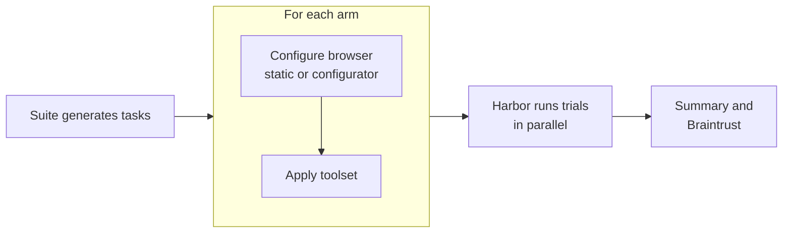

# Kernel Benchmarks

**How well do AI agents get everyday things done on the real web, and what makes them better?**

Booking a table, applying for a job, or finding a store's hours sounds easy until an agent has to do it on a live website. Success depends on more than the model:

- **Browser tools.** Is the agent driving Playwright code, a screenshot-and-click loop, or a purpose-built API?
- **Browser settings.** Is the browser stealthy? Which proxy does it use? Does the site even let it in?
- **Guidance.** Does the agent know what a site's bot protection looks for before it starts?

This repo measures those choices side by side. Each benchmark runs a set of real-website tasks under several configurations, called **arms**, in the same time window. You can then see what changed the outcome: the agent, its tools, or its browser.

Trials run on [Harbor](https://github.com/harbor-framework/harbor), an open framework for agent evaluations. Every trial gets its own [Kernel](https://www.kernel.sh) cloud browser, created fresh and deleted afterwards.

## How a benchmark is put together

| Piece | What it is | Example |
|---|---|---|
| **Suite** | A set of tasks, adapted into Harbor tasks, with its own scoring. | [ClawBench](https://github.com/TIGER-AI-Lab/ClawBench): 129 tasks on real websites, scored by intercepting the final request |
| **Toolset** | What the agent uses to drive the browser. | `kernel-mcp-local`: the [Kernel MCP server](https://github.com/kernel/kernel-mcp-server), built from source |
| **Agent** | A Harbor agent, model, and version. | Codex with `gpt-5.6-luna` |
| **Arm** | One agent + toolset + browser configuration. The thing being compared. | `codex-kernel-mcp-site-config` |
| **Configurator** | Optional. Picks browser settings per task, and can add advice for the agent. | `site-config`: asks Kernel's config registry what works on the task's site |
| **Benchmark** | A suite plus the arms to run on it. One GitHub workflow each. | `kernel-mcp-clawbench` |

A run turns those into trials:



Inside a trial:

1. Harbor creates a headful Kernel browser with that task's settings. The browser is a full VM.
2. Inside the VM, Harbor builds the task's image with Docker and installs the agent in that container.
3. The agent completes the task by driving the VM's browser through its toolset.
4. The suite's verifier scores the result. Harbor then deletes the browser.

## Quick start

You need [uv](https://docs.astral.sh/uv/). Preparing tasks needs no credentials:

```bash
uv sync
uv run bench prepare kernel-mcp-clawbench \
  --arms codex-kernel-mcp --tasks v2-1134-chapter-finder-redcross --out /tmp/prepared
```

This writes ready-to-run Harbor tasks you can inspect: `task.toml`, the instruction, the Dockerfile, and `environment/kernel-config.json` with the browser settings.

To run trials, export the credentials listed below, then:

```bash
uv run bench run kernel-mcp-clawbench \
  --arms codex-kernel-mcp --tasks v2-1134-chapter-finder-redcross
```

Harbor writes one job directory per arm under `jobs/`, containing rewards, trajectories, and verifier output. To summarize jobs, run `bun report/report.ts --arm <name>=<job dir>` (needs [Bun](https://bun.sh)).

`--tasks` takes comma-separated task IDs or `all`. `--concurrency` sets concurrent trials per arm. `--toolset-ref` builds a toolset from a specific git ref, e.g. a Kernel MCP server branch.

### Credentials

| Variable | Used by |
|---|---|
| `KERNEL_API_KEY` | Browsers, the config registry, and Kernel MCP. Must be scoped to a single [Kernel project](https://www.kernel.sh/docs) dedicated to benchmarks. |
| `OPENAI_API_KEY` / `ANTHROPIC_API_KEY` | Codex and Claude Code arms; the `site-config` configurator's model |
| `PURELY_MAIL_API_KEY`, `PURELY_MAIL_DOMAIN` | ClawBench, which gives each task a disposable email account |
| `CLAWBENCH_JUDGE_BASE_URL`, `CLAWBENCH_JUDGE_API_KEY`, `CLAWBENCH_JUDGE_MODEL`, `CLAWBENCH_JUDGE_API_TYPE` | ClawBench's LLM judge |
| `BRAINTRUST_API_KEY`, `BRAINTRUST_PROJECT` | Optional: publishing results |

## Running in GitHub Actions

Each benchmark has a manually triggered workflow:

```bash
gh workflow run kernel-mcp-clawbench.yml -f tasks=all -f concurrency=10
```

Credentials come from the repository's `benchmarks` environment. The job summary shows a table per arm. When Braintrust is configured, each run is also published there as one experiment with redacted trajectories. Raw job directories are never uploaded, because they contain task credentials.

## Current benchmarks

### `kernel-mcp-clawbench`

The Kernel MCP server on ClawBench.

| Arm | Agent | Browser |
|---|---|---|
| `codex-kernel-mcp` | Codex, `gpt-5.6-luna` | Stealth |
| `codex-kernel-mcp-site-config` | Codex, `gpt-5.6-luna` | From Kernel's config registry per site, plus the registry's guidance in the instruction |
| `claude-kernel-mcp` | Claude Code, `claude-sonnet-5` | Stealth |

ClawBench's primary score is the lenient reward. `kernel_mcp_valid` records whether the agent used Kernel MCP with only its assigned browser, so a failed task can be told apart from a trial that never used the toolset.

## Extending

### Add an arm

Copy a file in `arms/` and add its name to a benchmark:

```toml
agent = "claude-code"          # any Harbor agent
model = "claude-sonnet-5"
agent_version = "2.1.238"
toolset = "kernel-mcp-local"

[browser]
config = { stealth = true }    # Kernel POST /browsers params
configurator = "site-config"   # optional; its output is merged over config

[browser.configurator_args]
model = "anthropic/claude-haiku-5-5"
steering = true
```

`config` takes any [`POST /browsers`](https://www.kernel.sh/docs) parameter, such as `stealth`, `proxy`, `region`, `extensions`, or `viewport`. Browsers are always headful.

### Add a configurator

A configurator is an executable at `configurators/<name>/configure`. It reads a task on stdin and prints browser settings on stdout:

```
stdin:  {"task": {"config": "<task.toml>", "instruction": "<instruction>"}, "args": {...}}
stdout: {"browser": {"stealth": true}, "steering": "advice for the agent" | null, "provenance": {...}}
```

It never sees the verifier's files. `steering` is appended to the task instruction under "Site guidance". The harness saves each task's result in the arm's job directory as `browser-configurations.json`. Configurators may be nondeterministic, e.g. when they call an LLM.

### Add a toolset

Create `toolsets/<name>/toolset.py` with `apply(task_dirs, ref=None)`. It edits generated tasks, typically by:

- appending a layer to `environment/Dockerfile`,
- setting `environment.mcp_servers` in `task.toml`,
- adding instructions,
- appending a check to the verifier.

See `harness/tasks.py` for helpers.

### Add a suite

Create `suites/<name>/suite.py` with:

- `preflight()`: checks external dependencies before any browser is created.
- `generate(task_ids, out_dir)`: writes Harbor tasks and returns their directories. The tasks should run on the browser Harbor provides (`KERNEL_SESSION_ID`, `/harbor/kernel/connection.json`) and leave tool wiring to toolsets.

Then add `benchmarks/<name>.toml` and a workflow that calls `_run.yml`.

## Layout

```
benchmarks/      suite + arms per benchmark
arms/            agent, model, toolset, browser settings
suites/          task sets adapted to Harbor
toolsets/        browser tools for the agent
configurators/   per-task browser settings and guidance
harness/         preparation and running (Python)
report/          summary table and Braintrust publishing (TypeScript)
tests/
```

## Caveats

- **Live websites change.** Arms in one run share the same time window. Compare arms within a run rather than across days.
- **The Harbor provider is pinned to a fork.** Harbor is pinned to a `kernel/harbor` commit until [harbor-framework/harbor#2122](https://github.com/harbor-framework/harbor/pull/2122) is released.
- **Reporting assumes ClawBench.** The report and Braintrust publisher expect ClawBench-shaped rewards and step layout. They will be generalized when a second suite lands.

## License

[MIT](LICENSE)
